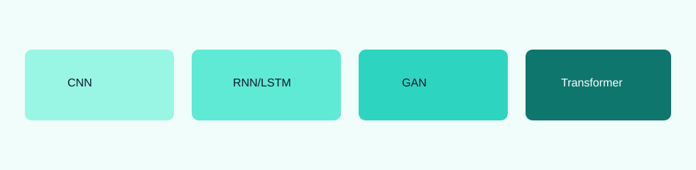
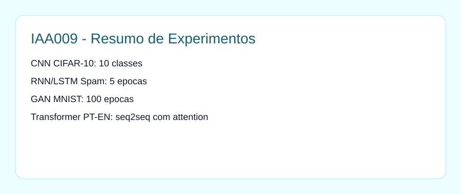

# Deep Learning Architectures

Colecao de exercicios praticos cobrindo quatro arquiteturas:

- CNN em CIFAR-10
- RNN/LSTM para spam detection
- GAN para geracao de digitos
- Transformer para traducao PT-EN

## Estrutura

- `notebooks/01_cnn_cifar10_classifier.ipynb`
- `notebooks/02_lstm_spam_detection.ipynb`
- `notebooks/03_gan_mnist_generator.ipynb`
- `notebooks/04_transformer_pt_en_translation.ipynb`

## Resultados numericos do escopo

- CIFAR-10: `10 classes`
- Spam detection: `5 epocas` (classificacao binaria)
- GAN MNIST: `100 epocas`
- Transformer PT-EN: tokenizacao e treino seq2seq com attention

## Imagens do projeto

## Datasets grandes

- Nao versionar datasets grandes no repositorio.
- Para execucao local, baixar datasets durante a execucao (API oficial) ou manter em `data/raw/` local.

## Reproducao local

1. `pip install -r requirements.txt`
2. Execute os notebooks individualmente.
